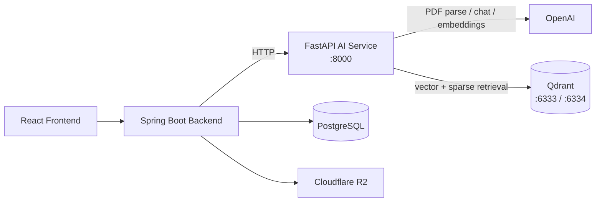
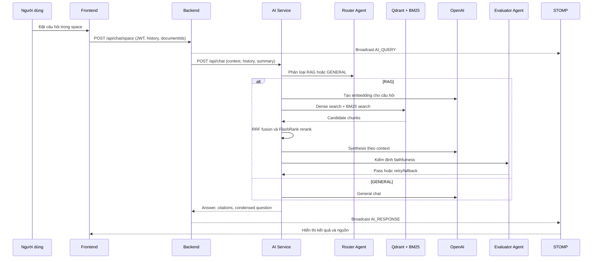

# Mora AI Service

AI microservice của Mora, cung cấp chức năng phân tích PDF, lập chỉ mục tài liệu, truy xuất RAG và chat với OpenAI.

## Vai trò trong kiến trúc



Frontend không gọi AI Service trực tiếp. Backend chịu trách nhiệm xác thực, lưu metadata/tệp và gọi AI Service qua HTTP. AI Service sử dụng Qdrant để lưu vector/chunk và OpenAI cho parse, embedding, tạo câu trả lời và đánh giá.

## Khả năng chính

- Phân tích PDF theo trang, hỗ trợ nội dung và bố cục/diagram qua OpenAI.
- Semantic chunking, tạo embedding và index tài liệu vào Qdrant.
- Hybrid retrieval (dense + BM25), rerank bằng FlashRank và trả citation cho chat.
- Chat và tóm tắt chat.

```text
app/
├── api/v1/endpoints/  # Endpoint chat, parse và index
├── core/              # Settings từ biến môi trường
├── schemas/           # Pydantic request/response model
└── services/          # Parse, chunking, vector, retrieval và chat
```

## Kiến trúc chatbot

AI Service triển khai chatbot theo mô hình điều phối nhiều agent. Backend truyền câu hỏi, lịch sử, bản tóm tắt, không gian, document được chọn; service trả về answer, citation, câu hỏi đã cô đọng và metadata prompt. API key được quản lý duy nhất tại AI Service bằng biến môi trường.



### Các agent và dữ liệu đi qua chúng

| Thành phần | Đầu vào | Xử lý | Đầu ra |
| --- | --- | --- | --- |
| Router Agent | Câu hỏi, tối đa 12 message gần nhất, chat summary | OpenAI phân loại ý định `RAG` hoặc `GENERAL` | Nhánh xử lý phù hợp. Mặc định ưu tiên RAG cho câu hỏi học thuật. |
| Retrieval Agent | Câu hỏi, `spaceId`, `documentIds` tùy chọn | Tạo query embedding; truy vấn dense ở Qdrant và sparse BM25; RRF hợp nhất; FlashRank chọn top-K | Context chunk gồm nội dung, tài liệu, trang và section. |
| Synthesis Agent | Câu hỏi, context, history, summary | OpenAI tạo JSON có answer, citation, câu hỏi cô đọng và cờ đủ thông tin | Câu trả lời RAG có citation theo tài liệu/trang. |
| Evaluator Agent | Answer và context đã chọn | OpenAI chấm faithfulness và phát hiện hallucination | Pass nếu faithful hoặc điểm từ `0.7`; nếu không, thử synthesis lại. |
| General Chat Agent | Câu hỏi, history, summary | OpenAI trả lời kiến thức chung, không dựa vào document | Câu trả lời không citation. |

### Luồng RAG chi tiết

1. Router chọn `RAG` khi câu hỏi liên quan tới kiến thức/tài liệu; người dùng có thể giới hạn phạm vi bằng `documentIds`.
2. Retrieval dùng `OPENAI_EMBEDDING_MODEL` để embed câu hỏi, tìm vector trong collection OpenAI và từ khóa qua BM25.
3. Reciprocal Rank Fusion (RRF) hợp nhất hai tập kết quả thành tối đa 20 candidate. FlashRank rerank candidate và trả `RETRIEVAL_TOP_K` chunk tốt nhất; nếu FlashRank lỗi, thứ hạng RRF là phương án dự phòng.
4. Synthesis Agent chỉ dẫn OpenAI trả lời bám sát context và trả citation có `documentId`, `documentName`, `pageNumber` và quote. AI Service gộp citation trùng tài liệu/trang trước khi trả về Backend.
5. Evaluator Agent kiểm tra answer với context. Nếu không faithful và điểm dưới `0.7`, service synthesis lại tối đa một lần nữa (hai attempt tổng cộng).

### Fallback và quản lý hội thoại

- Nếu Router chọn `GENERAL`, chatbot trả lời bằng General Chat ngay, không có citation.
- Nếu RAG không tìm được context, tài liệu không đủ thông tin hoặc không qua kiểm định sau các attempt, chatbot chuyển sang General Chat. Khi fallback từ RAG, câu trả lời có cảnh báo rằng tài liệu không đủ thông tin và không có citation.
- Prompt chỉ dùng tối đa 12 message lịch sử gần nhất, cùng chat summary do Backend cung cấp. Backend tạo/cập nhật summary sau mỗi 6 phản hồi assistant để giữ context dài hạn mà không phải gửi toàn bộ lịch sử.
- Lỗi nhà cung cấp trả lỗi dịch vụ; không chuyển lỗi thành câu trả lời thành công. Khi `RETRIEVAL_ENABLED=false`, chat dùng nội dung trang do backend cung cấp và không truy vấn collection vector. Khởi động lại AI Service sau khi sửa `.env` để nạp key mới.
- Khi không có kết quả retrieval, AI Service có thể dùng `context` thô do Backend gửi làm phương án dự phòng; nếu context này cũng trống thì chuyển General Chat.

Các model và ngưỡng retrieval được quản trị viên điều chỉnh qua biến môi trường tại AI Service. Để biết cơ chế lưu lịch sử, phân quyền và broadcast, xem [README Backend](../mora-backend/README.md#điều-phối-chatbot).

## API

Service chạy dưới prefix `/api`:

| Endpoint | Chức năng |
| --- | --- |
| `POST /api/chat` | Tạo phản hồi chat RAG/OpenAI. |
| `POST /api/chat/summarize` | Tóm tắt lịch sử chat. |
| `POST /api/index` | Chunk, embed và index trang tài liệu vào Qdrant. |
| `POST /api/parse` | Phân tích tệp PDF. |

Tài liệu tương tác theo schema hiện hành có tại `http://localhost:8000/docs`; ReDoc có tại `http://localhost:8000/redoc`.

## Yêu cầu

- Python 3.11+ (Docker image dùng Python 3.11).
- Qdrant, mặc định `localhost:6333` và gRPC `6334`.
- OpenAI API key do quản trị viên cấu hình trong AI Service.

Khởi động Qdrant bằng Docker Compose ở repo Backend:

```bash
cd ../mora-backend
docker compose up -d qdrant
cd ../mora-ai
```

## Cấu hình môi trường

Sao chép `.env.example` thành `.env` trong `mora-ai`, rồi đặt `OPENAI_API_KEY`.
Key không nằm trong frontend, backend Java hoặc request HTTP giữa các service.

| Biến | Mặc định | Mục đích |
| --- | --- | --- |
| `OPENAI_API_KEY` | Bắt buộc | Key chung phía máy chủ |
| `OPENAI_MODEL` | `gpt-5-mini` | Chat, router, evaluator, tóm tắt |
| `OPENAI_PARSER_MODEL` | `gpt-5-mini` | Đọc PDF từng trang qua Responses API |
| `OPENAI_EMBEDDING_MODEL` | `text-embedding-3-small` | Embedding 1536 chiều |
| `OPENAI_TIMEOUT` | `60` | Timeout mỗi lần gọi, giây |
| `OPENAI_MAX_RETRIES` | `2` | Số lần SDK thử lại tối đa |
| `RETRIEVAL_ENABLED` | `false` | Chỉ bật sau khi lập lại chỉ mục thành công |

Giữ cấu hình Qdrant (`QDRANT_HOST`, `QDRANT_PORT` hoặc `QDRANT_URL`, `QDRANT_API_KEY`) tại service này.
Không commit `.env`. Giữ AI Service trong mạng nội bộ; frontend chỉ gọi backend có xác thực.

## Chuyển chỉ mục sang OpenAI

1. Tạm ngừng nhận chat/tải tài liệu trong thời gian bảo trì. Khởi động AI Service với key hợp lệ và `RETRIEVAL_ENABLED=false`.
2. Khởi động backend với `AI_REINDEX_ON_STARTUP=true`. Tác vụ đọc nội dung trang đã lưu của tài liệu `READY`, `INDEXING`, `FAILED`, tạo embedding và ghi vào `mora_chunks_openai_v1`. Không đọc lại PDF hay sửa hội thoại. Tài liệu chưa có trang lưu sẽ báo thất bại, cần xử lý lại tài liệu đó.
3. Kiểm tra log `OpenAI reindex complete: success=..., failed=0`. Nếu có lỗi, backend không hoàn tất startup; sửa lỗi rồi chạy lại. ID chunk ổn định, chunk cũ không còn trong tài liệu được dọn sau khi ghi chunk mới thành công.
4. Đặt lại `AI_REINDEX_ON_STARTUP=false`; bật `RETRIEVAL_ENABLED=true`, khởi động lại AI Service/backend rồi mở lại ứng dụng. Cài đặt mới chưa có tài liệu vẫn thực hiện bước kiểm tra với tổng 0 tài liệu.

Collection cũ được giữ nguyên. Không tự xóa collection khi sai kích thước; không dùng chung vector của hai nhà cung cấp. BM25 được dựng lại từ collection OpenAI khi cần sau khi restart. Nếu đổi embedding model lần nữa, cần một collection mới và quy trình lập lại chỉ mục tương ứng.
Các bảng cấu hình AI cá nhân cũ được giữ nguyên trong database nhưng không còn được sử dụng.

## Kiểm thử

```bash
python -m unittest discover -s tests -v
```

Các kiểm thử dùng mock OpenAI và Qdrant in-memory, không tốn phí API.

## Chạy local

```bash
python -m venv venv
source venv/bin/activate          # Windows: venv\Scripts\activate
pip install -r requirements.txt
uvicorn app.main:app --host 0.0.0.0 --port 8000 --reload
```

Kiểm tra nhanh:

```bash
curl http://localhost:8000/api/hello
```

## Chạy bằng Docker

```bash
docker build -t mora-ai .
docker run --env-file .env -p 8000:8000 mora-ai
```

Khi chạy container, đặt `QDRANT_URL` hoặc `QDRANT_HOST` phù hợp với mạng Docker; `localhost` bên trong container không trỏ về máy host.

## Tích hợp Backend

Backend mặc định gọi service tại `http://localhost:8000`; thay đổi bằng `AI_SERVICE_URL` trong `.env` của Backend. Hướng dẫn chạy toàn bộ stack có tại [`../mora-backend/README.md`](../mora-backend/README.md).
