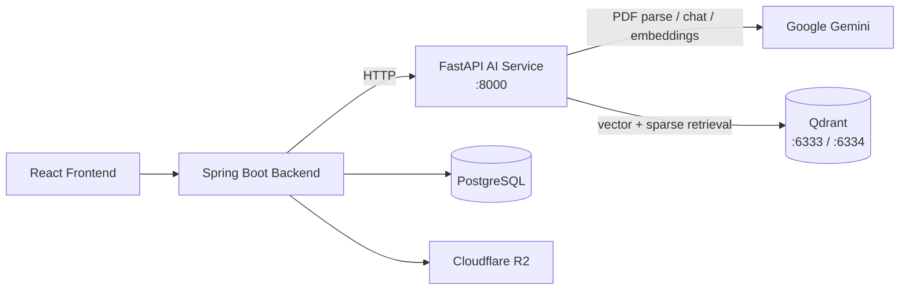
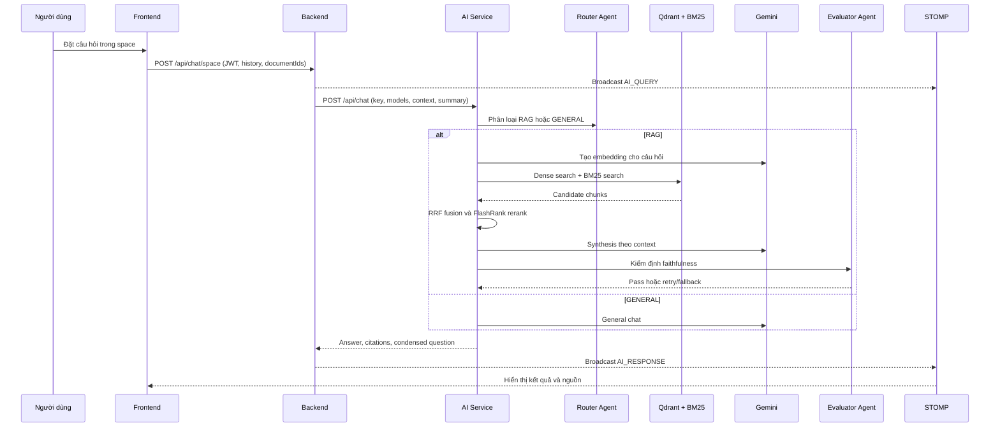

# Mora AI Service

AI microservice của Mora, cung cấp chức năng phân tích PDF, lập chỉ mục tài liệu, truy xuất RAG và chat với Gemini.

## Vai trò trong kiến trúc



Frontend không gọi AI Service trực tiếp. Backend chịu trách nhiệm xác thực, lưu metadata/tệp và gọi AI Service qua HTTP. AI Service sử dụng Qdrant để lưu vector/chunk và Gemini cho parse, embedding, tạo câu trả lời và đánh giá.

## Khả năng chính

- Phân tích PDF theo trang, hỗ trợ nội dung và bố cục/diagram qua Gemini.
- Semantic chunking, tạo embedding và index tài liệu vào Qdrant.
- Hybrid retrieval (dense + BM25), rerank bằng FlashRank và trả citation cho chat.
- Chat, tóm tắt chat, kiểm tra Gemini API key.

```text
app/
├── api/v1/endpoints/  # Endpoint chat, parse và index
├── core/              # Settings từ biến môi trường
├── schemas/           # Pydantic request/response model
└── services/          # Parse, chunking, vector, retrieval và chat
```

## Kiến trúc chatbot

AI Service triển khai chatbot theo mô hình điều phối nhiều agent. Backend truyền câu hỏi, lịch sử, bản tóm tắt, không gian, document được chọn và API key/model của từng người dùng; service trả về answer, citation, câu hỏi đã cô đọng và metadata prompt. API key không được lưu tại AI Service.



### Các agent và dữ liệu đi qua chúng

| Thành phần | Đầu vào | Xử lý | Đầu ra |
| --- | --- | --- | --- |
| Router Agent | Câu hỏi, tối đa 12 message gần nhất, chat summary | Gemini phân loại ý định `RAG` hoặc `GENERAL` | Nhánh xử lý phù hợp. Mặc định ưu tiên RAG cho câu hỏi học thuật. |
| Retrieval Agent | Câu hỏi, `spaceId`, `documentIds` tùy chọn | Tạo query embedding; truy vấn dense ở Qdrant và sparse BM25; RRF hợp nhất; FlashRank chọn top-K | Context chunk gồm nội dung, tài liệu, trang và section. |
| Synthesis Agent | Câu hỏi, context, history, summary | Gemini tạo JSON có answer, citation, câu hỏi cô đọng và cờ đủ thông tin | Câu trả lời RAG có citation theo tài liệu/trang. |
| Evaluator Agent | Answer và context đã chọn | Gemini chấm faithfulness và phát hiện hallucination | Pass nếu faithful hoặc điểm từ `0.7`; nếu không, thử synthesis lại. |
| General Chat Agent | Câu hỏi, history, summary | Gemini trả lời kiến thức chung, không dựa vào document | Câu trả lời không citation. |

### Luồng RAG chi tiết

1. Router chọn `RAG` khi câu hỏi liên quan tới kiến thức/tài liệu; người dùng có thể giới hạn phạm vi bằng `documentIds`.
2. Retrieval Agent dùng `GEMINI_EMBEDDING_MODEL` để embed câu hỏi, tìm dense vector trong Qdrant và BM25 sparse trong vector store.
3. Reciprocal Rank Fusion (RRF) hợp nhất hai tập kết quả thành tối đa 20 candidate. FlashRank rerank candidate và trả `RETRIEVAL_TOP_K` chunk tốt nhất; nếu FlashRank lỗi, thứ hạng RRF là phương án dự phòng.
4. Synthesis Agent chỉ dẫn Gemini trả lời bám sát context và trả citation có `documentId`, `documentName`, `pageNumber` và quote. AI Service gộp citation trùng tài liệu/trang trước khi trả về Backend.
5. Evaluator Agent kiểm tra answer với context. Nếu không faithful và điểm dưới `0.7`, service synthesis lại tối đa một lần nữa (hai attempt tổng cộng).

### Fallback và quản lý hội thoại

- Nếu Router chọn `GENERAL`, chatbot trả lời bằng General Chat ngay, không có citation.
- Nếu RAG không tìm được context, tài liệu không đủ thông tin hoặc không qua kiểm định sau các attempt, chatbot chuyển sang General Chat. Khi fallback từ RAG, câu trả lời có cảnh báo rằng tài liệu không đủ thông tin và không có citation.
- Prompt chỉ dùng tối đa 12 message lịch sử gần nhất, cùng chat summary do Backend cung cấp. Backend tạo/cập nhật summary sau mỗi 6 phản hồi assistant để giữ context dài hạn mà không phải gửi toàn bộ lịch sử.
- Khi không có kết quả retrieval, AI Service có thể dùng `context` thô do Backend gửi làm phương án dự phòng; nếu context này cũng trống thì chuyển General Chat.

Các model và ngưỡng retrieval được điều chỉnh qua cài đặt người dùng do Backend gửi hoặc biến môi trường đã nêu ở phần cấu hình. Để biết cơ chế lưu lịch sử, phân quyền và broadcast, xem [README Backend](../mora-backend/README.md#điều-phối-chatbot).

## API

Service chạy dưới prefix `/api`:

| Endpoint | Chức năng |
| --- | --- |
| `POST /api/chat` | Tạo phản hồi chat RAG/Gemini. |
| `POST /api/chat/summarize` | Tóm tắt lịch sử chat. |
| `POST /api/chat/validate-key` | Kiểm tra Gemini API key và model. |
| `POST /api/index` | Chunk, embed và index trang tài liệu vào Qdrant. |
| `POST /api/parse` | Phân tích tệp PDF. |

Tài liệu tương tác theo schema hiện hành có tại `http://localhost:8000/docs`; ReDoc có tại `http://localhost:8000/redoc`.

## Yêu cầu

- Python 3.11+ (Docker image dùng Python 3.11).
- Qdrant, mặc định `localhost:6333` và gRPC `6334`.
- Gemini API key cho chức năng cần mô hình Google.

Khởi động Qdrant bằng Docker Compose ở repo Backend:

```bash
cd ../mora-backend
docker compose up -d qdrant
cd ../mora-ai
```

## Cấu hình môi trường

`Settings` hỗ trợ đọc cả `.env` cục bộ và `../mora-backend/.env`. Có thể tạo `.env` trong repo này với các giá trị sau:

```env
GEMINI_API_KEY=your_key
GEMINI_MODEL_NAME=gemini-3.1-flash-lite
QDRANT_HOST=localhost
QDRANT_PORT=6333
QDRANT_GRPC_PORT=6334
```

Các biến tùy chọn khác gồm `QDRANT_URL`, `QDRANT_API_KEY`, `GEMINI_EMBEDDING_MODEL`, `GEMINI_EVALUATOR_MODEL_NAME`, `GEMINI_EVALUATOR_EMBEDDINGS_MODEL_NAME`, `RETRIEVAL_TOP_K`, `RETRIEVAL_DENSE_LIMIT` và `RETRIEVAL_SPARSE_LIMIT`. Không commit API key.

## Chạy local

```bash
python -m venv venv
source venv/bin/activate          # Windows: venv\Scripts\activate
pip install -r requirements.txt
uvicorn app.main:app --host 0.0.0.0 --port 8000 --reload
```

Kiểm tra nhanh:

```bash
curl http://localhost:8000/api/hello
```

## Chạy bằng Docker

```bash
docker build -t mora-ai .
docker run --env-file .env -p 8000:8000 mora-ai
```

Khi chạy container, đặt `QDRANT_URL` hoặc `QDRANT_HOST` phù hợp với mạng Docker; `localhost` bên trong container không trỏ về máy host.

## Tích hợp Backend

Backend mặc định gọi service tại `http://localhost:8000`; thay đổi bằng `AI_SERVICE_URL` trong `.env` của Backend. Hướng dẫn chạy toàn bộ stack có tại [`../mora-backend/README.md`](../mora-backend/README.md).
